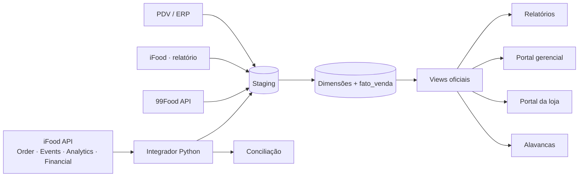

# Fermento

**Plataforma de dados para redes de food service:** junta as vendas do caixa (PDV), do iFood e da 99Food num só banco, gera relatórios por rede e por loja, aponta as alavancas que fazem o GMV crescer e confere o que as plataformas venderam contra o que repassaram.

> Projeto real, construído para uma rede de franquias de food service com cerca de 60 lojas. Este repositório é a versão pública: **não contém dados de clientes, faturamento, CNPJ, códigos de loja das plataformas nem credenciais.**

---

## O problema

Uma loja de delivery vende por três canais que não se conversam. Cada um tem o próprio portal, o próprio relatório e o próprio jeito de contar pedido, desconto e taxa. Para responder "quanto a rede vendeu, quanto sobrou no caixa e o que fazer para vender mais", alguém precisa baixar planilhas, colar, conferir e torcer para não errar.

## O que o Fermento faz

| Módulo | O que entrega |
|---|---|
| **Conectores** | Pedidos e eventos (iFood Order/Events), KPIs D-1 (iFood Analytics), vendas, lançamentos, repasses e arquivo de conciliação (iFood Financial), pedidos e promoções (99Food), vendas do PDV |
| **Data warehouse** | Staging → dimensões → pontes em formato longo → fato de vendas → views oficiais, em SQL Server |
| **Relatórios** | Rede, canal, loja e produto, com MoM e YoY e conferência contra a fonte |
| **Portal gerencial** | Um HTML com filtros, ranking misto de lojas (pesos ajustáveis), loja × loja e alertas que separam *falha de dado* de *movimento de negócio* |
| **Portal da loja** | Um arquivo por loja, só com os dados dela |
| **Alavancas** | Regras que apontam ação por loja: ruptura, conversão, anúncio, cancelamento, preço fora da regra, promoção que não paga |
| **Conciliação** | Vendido × repassado, pedido a pedido; repasse = Σ lançamentos com impacto no repasse |

## Arquitetura



## Decisões de projeto que valem a leitura

- **Nenhuma venda é descartada por falta de mapeamento.** O que não casa entra na fato com `status_mapeamento` dizendo por quê. O total sempre fecha com a origem.
- **Toda carga é idempotente.** Rodar duas vezes dá o mesmo resultado. Apaga por lista de chaves, conta a origem antes de apagar e aborta se vier vazia.
- **Código é texto, não número.** Identificadores de 19 dígitos perdem precisão em ponto flutuante; todo código é `VARCHAR` e toda leitura de Excel usa `dtype=str`.
- **O motivo mora no banco.** Canal fora do faturamento oficial não é filtro escondido no BI: é atributo da dimensão com a justificativa.
- **Canal novo é INSERT, nunca ALTER TABLE.** Pontes loja × canal e produto × canal em formato longo.
- **Faturamento real da plataforma ≠ preço pago pelo cliente.** No 99Food, o valor da loja é `total_price − shop_subside_price`: usar o preço pago pelo cliente lançaria no prejuízo da loja um desconto que a plataforma bancou.
- **Conferência independente.** Toda entrega de números passa por recálculo a partir da fonte (última auditoria: 376 checagens, 0 divergência).

## Integração oficial com o iFood

O integrador (`src/integrador_ifood`) usa a API oficial de parceiros:

- **Order + Events:** polling a cada 30 s, acknowledgment de todos os eventos, deduplicação, ações de pedido e painel Flask. Homologado.
- **Analytics:** KPIs D-1 por loja ou por rede, retry com backoff, mensagens de erro em português. Aprovado no wizard de homologação.
- **Financial:** Sales, Financial Events, Settlement e Reconciliation On-Demand; extração semanal até 366 dias, gravação idempotente e conferência do repasse com tolerância de 0,01%.

Lições que a documentação não conta (e o código já trata): o acknowledgment de eventos é uma lista de objetos `[{"id": ...}]`; o cancelamento exige `cancellationCode`; a conciliação usa o campo `competence`; settlement filtra por `beginCalculationDate`.

## Como o projeto trata segredo e dado real

Duas regras que valem para todo o repositório, e que o próprio código aplica:

- **Credencial vive só no `.env`**, que é ignorado pelo Git. O `env.example` traz
  as variáveis com valor vazio. Segredo que apareceu em chat, log ou arquivo de
  exemplo é tratado como **exposto**: a correção é regenerar a chave, não apagar
  o arquivo.
- **`.gitignore` por padrão, nunca por lista de nomes.** `*.db`, `*.log`,
  `*.env`, `*tokens*.json`, `*.csv` — lista de nomes envelhece e deixa passar o
  arquivo que nasceu depois dela.
- **Código e dado real nunca na mesma pasta.** O gerador do portal lê *todo*
  `.csv` da pasta que recebe; com os dois juntos, uma cópia acidental para o
  repositório é questão de tempo. O caminho dos dados vem de variável de
  ambiente (`FERMENTO_DADOS`), fora da árvore do código.

O `.gitignore` é conferido num repositório descartável antes de valer: recria-se
a árvore só com nomes de arquivo vazios e compara-se o que o Git versionaria
contra o que ele ignoraria.

## Documentação para quem for ler o código

`src/integrador_ifood` traz, junto do código, o que normalmente se perde:

| Arquivo | Conteúdo |
|---|---|
| `CLAUDE.md` | como rodar, as regras que não se negociam, o que não fazer |
| `docs/ARQUITETURA.md` | o caminho dos dados, quem é cada módulo e os pontos de concentração do grafo de chamadas |
| `docs/AMBIENTE.md` | grupos de credencial, app centralizado × distribuído, teste × produção |
| `docs/FINANCIAL.md` | as quatro APIs financeiras, limites e conciliação |
| `docs/ANALYTICS.md` | KPIs, o wizard de homologação e o limite de uma tentativa a cada quatro horas |
| `docs/ERROS.md` | sintoma → causa → solução, só com erro reproduzido |

## Estrutura

```
src/
  integrador_ifood/   Python · requests · Flask · SQLite (provisório)
    CLAUDE.md         instruções de trabalho na pasta
    docs/             arquitetura, ambiente, Financial, Analytics, erros
  portal_gerencial/   gerador Python + modelo HTML (os dados entram na geração)
  banco/              scripts SQL Server (versão sanitizada em preparação)
docs/                 arquitetura do produto, regras de negócio, decisões
```

## Como rodar o integrador

```bash
cd src/integrador_ifood
pip install -r requirements.txt
copy env.example .env      # preencha com as credenciais do SEU app no Portal do Desenvolvedor
python main.py --auto-confirm
python painel.py           # http://127.0.0.1:5000
```

O gerador do portal procura os CSVs em `FERMENTO_DADOS` (ou `~/dados-fermento`),
**fora** da pasta do código:

```bash
set FERMENTO_DADOS=/caminho/da/pasta/com/os/csvs
python src/portal_gerencial/APP_04_gerador_gerencial.py
```

## Tecnologias

SQL Server (LocalDB → Azure SQL Database) · T-SQL · Python 3.13 (pandas, pyodbc, requests, Flask) · HTML/CSS/JS sem framework · Power BI.

## Roadmap

1. ~~Higiene e alinhamento do time~~ — segredos fora do código, `.gitignore` por
   padrão, dado real fora da pasta de código, documentação junto do código
2. Um banco só (Azure SQL; dados da API no warehouse)
3. Cargas agendadas, sem intervenção manual
4. Alavancas com funil e cancelamento; conciliação mensal
5. Multi-rede com segurança por linha e login

## Autor

**Bruno Teófilo** — analista de dados. Projeto desenvolvido com apoio de agentes de IA (Claude), organizados como um time: DBA, analista de BI, desenvolvedor full stack, especialista em API e um coordenador.
